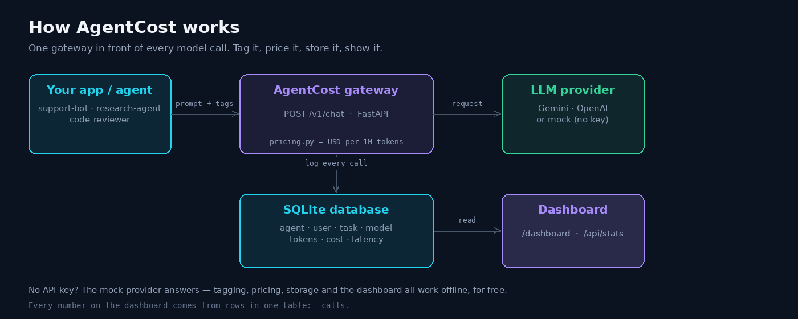
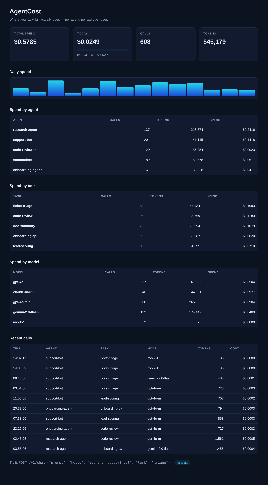

<div align="center">

# 💰 AgentCost

### Know which agent is burning your LLM budget — per agent, per task, per user.

**A self-hosted gateway + dashboard for LLM cost attribution.**




</div>

---

## 📍 Project status

**Where it stands:** Phase 1 is working locally — the gateway, the cost engine, storage and the dashboard all run. Nothing is deployed yet.

| Phase | What | Status |
|:--|:--|:--|
| **1 · Local MVP** | FastAPI gateway · cost engine · SQLite logging · dashboard · budget alert · offline mock provider | ✅ **done** |
| **2 · Containerise** | `Dockerfile` · `docker-compose.yml` · healthcheck · env-based config | 🚧 **next** |
| **3 · Deploy on AWS** | Terraform (ECR + ECS Fargate + RDS/SQLite on EBS) · live public URL · CloudWatch logs | ⬜ not started |
| **4 · Harden & document** | tests · API key auth · CSV export · per-user drilldown · demo video | ⬜ not started |

Progress detail lives in [ROADMAP.md](ROADMAP.md). Last updated: **25 Nov 2026**.

---

## 🧩 What problem does this solve?

Teams building with LLM APIs get one number at the end of the month: a total bill. Nobody can say *which agent, feature or customer* spent it. Infrastructure FinOps tools price servers and storage — almost none attribute **token spend** back to a product surface, and per-agent cost attribution is still one of the least-solved problems in AI operations.

AgentCost is a **gateway** that sits in front of your model calls. Every request passes through it, gets tagged, priced and stored — so the dashboard can answer:

- Which **agent** is expensive? (`research-agent` vs `support-bot`)
- Which **task** is expensive? (`ticket-triage` vs `doc-summary`)
- Which **model** is doing the damage? (one `gpt-4o` call costs ~16× a `gpt-4o-mini` call)
- Are we over today's **budget**?

---

## 🖥️ What works today



| | |
|---|---|
| **Gateway** | `POST /v1/chat` — tags every call with `agent`, `user_id`, `task`, `model` |
| **Cost engine** | `pricing.py` price table (USD per 1M tokens) → cost per call, per row |
| **Storage** | SQLite `calls` table: timestamp, agent, user, task, model, tokens, cost, latency |
| **Dashboard** | total spend · today vs budget · spend by agent / task / model · daily sparkline · recent calls |
| **JSON API** | `GET /api/stats` — the same data for any future frontend |
| **Budget alert** | `AGENTCOST_BUDGET` (default $5/day) → red card + `over_budget: true` in the response |
| **Offline mode** | no API key needed — a mock provider answers, so the full pipeline is testable for free |
| **Real models** | set `GEMINI_API_KEY` or `OPENAI_API_KEY` and the same route calls the real model |

---

## 🚀 Run it locally

```bash
pip install -r requirements.txt

python seed.py            # optional: 14 days of demo traffic (~600 calls)
uvicorn app:app --reload  # or: python -m uvicorn app:app --reload
```

Open **http://127.0.0.1:8000/dashboard**

Send a call through the gateway:

```bash
curl -X POST http://127.0.0.1:8000/v1/chat \
  -H "Content-Type: application/json" \
  -d '{"prompt":"Summarise this ticket","agent":"support-bot","user_id":"u_101","task":"ticket-triage"}'
```

---

## 🗂️ Files

| File | What it does | Status |
|:--|:--|:--|
| `app.py` | FastAPI gateway + server-rendered dashboard | ✅ |
| `db.py` | SQLite schema, insert, totals, breakdown queries | ✅ |
| `pricing.py` | Model price table + cost / token helpers | ✅ |
| `seed.py` | Generates realistic demo traffic | ✅ |
| `architecture.png` | Diagram used in this README | ✅ |
| `dashboard.png` | Screenshot used in this README | ✅ |
| `Dockerfile` | Container image for the gateway | 🚧 next |
| `docker-compose.yml` | Gateway + volume, one command to run | 🚧 next |
| `tests/test_app.py` | Cost math + gateway + dashboard tests | ⬜ |
| `infra/*.tf` | Terraform: ECR, ECS Fargate, logs, DB | ⬜ |
| `.github/workflows/ci.yml` | Test + build + push image on every push | ⬜ |

---

## ⚠️ Honest limitations

- **Prototype, not production.** No authentication, no rate limiting, SQLite (single file, single writer).
- **Price table is manual.** Providers change prices; `pricing.py` must be updated by hand.
- **Token counts from the provider.** For the mock provider they are estimated (~4 chars per token), not exact.
- **Single process.** Not built for concurrent writes at scale yet — that is what Phase 3 (RDS) fixes.

---

## 🗺️ Roadmap

- [x] Gateway + cost calculator + SQLite logging
- [x] Dashboard: totals, per-agent / per-task / per-model breakdown, budget alert
- [x] Offline mock provider (runs with zero API keys)
- [ ] `Dockerfile` + `docker-compose.yml`
- [ ] Tests: cost math, gateway contract, empty-database dashboard
- [ ] GitHub Actions CI (lint + tests on push)
- [ ] Terraform deploy on AWS (ECS Fargate + RDS) with a public URL
- [ ] API keys per tenant + rate limiting
- [ ] Per-user drilldown page and CSV export
- [ ] Weekly email digest of the biggest cost movers

---

## 👩‍💻 Author

**Khushi Yadav** — B.Tech CSE (AI & ML), Lucknow · Cloud + AI/ML
[GitHub](https://github.com/khushiyadav-Dev) · [LinkedIn](https://www.linkedin.com/in/khushi-yadav-6417213a7)

<sub>Built to answer one question every team asks too late: where did the token budget actually go?</sub>
